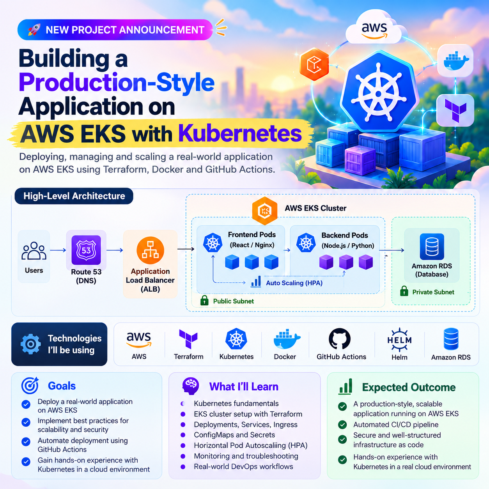

# production-style-App-aws-eks-kubernetes-platform (UNDER-🚧-BUILDING)
Production-style application deployment on AWS EKS using Terraform, Kubernetes, Docker and GitHub Actions.
---

## 🏗️ Architecture

---
